<div align="center">

<a href="https://zline.vercel.app">
  
</a>

<br>

*A high-performance real-time messaging, WebRTC calling, and AI-grounded communication platform built with Next.js 14, Web Crypto E2EE, Socket.IO, WebRTC, Zino AI with Platform RAG, and Obscura Headless Browser.*

<br>

[](https://zline.vercel.app)
[]()
[]()
[](./LICENSE)

<br>


</div>

---

## 🛡️ What's New in v3.0: Multi-Device Cryptographic Messaging & Cross-Device E2EE

Zline v3.0 transforms the platform into an enterprise-grade, multi-device end-to-end encrypted communication system adhering to the core principle:
> **"One account. Multiple trusted devices. Independent cryptographic identities. End-to-end encrypted communication."**

### 🔑 Cryptographic Architecture Highlights
- 📱 **Independent Device Cryptographic Identities**: Every registered device (laptops, smartphones, tablets, browsers) generates and maintains its own isolated 2048-bit RSA-OAEP keypair. Private keys never leave the device, are never uploaded to MongoDB or WebSockets, and are stored securely using browser **IndexedDB** (`zline-crypto-store`).
- ✉️ **Multi-Recipient Key Envelopes (`keyEnvelopes`)**: Senders generate an ephemeral AES-256-GCM message key and wrap it separately for every authorized recipient device, plus the sender's own other devices. This enables seamless, instantaneous cross-device history synchronization without backend plaintext exposure.
- 📲 **Secure QR-Code Device Pairing**: Authenticate companion devices via dynamic QR codes with short-lived cryptographic nonces (5-minute TTL), single-use HMAC authorization tokens, and strict out-of-band SHA-256 fingerprint verification.
- ⚙️ **Linked Devices Management Dashboard**: Access `Settings → Security → Linked Devices` to view registered devices, inspect SHA-256 fingerprints, rename endpoints, approve companion link requests, and immediately revoke compromised devices.
- 🚫 **Real-Time Device Revocation**: Revoking a device instantly broadcasts a `device_revoked` event via Socket.IO, scrubs local cryptographic stores, logs out the revoked device, and permanently excludes its public key from future message-key distributions.
- 🔒 **Fail-Closed Security & Tamper Resistance**: Strict integrity checking prevents silent fallbacks. AES-GCM authentication tag verification rejects any tampered ciphertext, corrupted IV, or substituted key envelope.
- 🧪 **18-Scenario Automated Security Test Suite**: Comprehensive automated test script validating multi-device routing, offline queueing, key wrapping, tamper resistance, and zero-knowledge backend ciphertext storage. Run with `npm run test:crypto`.

---

## 🌟 Standout Features That Set Zline Apart

### ⚡ 1. "Catch Me Up" (Zero-Knowledge AI Conversation Briefing)
- **Instant Catch-Up**: Catch up on busy group chats or long threads in 3 seconds without scrolling through 50+ messages.
- **Client-Side Privacy Preserved**: Because messages are decrypted locally on the device, Zline securely packages recent plaintext client-side and prompts Zino AI for an executive summary:
  - **📌 Executive Summary**: 1–2 punchy sentences capturing what the discussion was about.
  - **💡 Key Takeaways**: Bulleted decisions, discussion topics, and updates.
  - **✅ Action Items & Tasks**: Actionable commitments and next steps agreed upon.
- Includes a 1-click **"Copy Briefing"** button for clipboard exporting.

### ⏳ 2. Disappearing Messages Lifecycle & Storage Management
- **Automatic Server Auto-Purge**: Messages automatically self-destruct after the chosen retention duration via MongoDB TTL indexing (`expireAfterSeconds: 0`), preventing server storage overload.
- **Configurable Per Chat**: Set retention timers for **1 hour**, **6 hours**, **12 hours**, **1 day**, **3 days**, or **7 days** (maximum retention policy).
- **Client-Side Query Filtering**: Expired messages vanish immediately from the UI, even before MongoDB's background purge thread triggers.
- **Plaintext History Export**: Users can export their full decrypted conversation history at any time before expiry as a cleanly formatted `.txt` archive via the header download button.

### 🔗 3. Rich OpenGraph Link Previews & Clickable Hyperlinks
- **Automatic Metadata Unfurling**: Shared URLs automatically render responsive OpenGraph preview cards showing the website thumbnail, title, description snippet, site name, and favicon.
- **SSRF Protection & Safe Browsing**: Backend endpoint `/api/link-preview` strictly blocks internal/private IP ranges (`localhost`, `127.0.0.1`, `10.x.x.x`, `192.168.x.x`, `::1`) with a 4-second timeout.
- **In-Memory Caching**: Link previews are cached in memory to eliminate redundant fetches during chat navigation and scrolling.

### ⏩ 4. Variable Playback Speed for Voice Messages
- **1x / 1.5x / 2x Speed**: Built-in voice player supports instant speed switching with a single tap.
- **Visual Waveform**: Audio messages render animated waveforms with seekable progress bars and exact playback timers.

### 📁 5. Multi-File Attachments & 50MB Selection Limit
- **Multi-File Selection & Drag-and-Drop**: Stage and send multiple images, documents, audio clips, archives, and code files simultaneously.
- **Interactive Staging Strip**: Preview staged files with individual removal (`✕`), batch clearing, size usage counters, and optional message captions.
- **50MB Cumulative Quota**: Frontend and backend enforce a strict 50MB per-selection limit with real-time size validation.
- **Granular Progress Bar**: Live upload progress indicator tracking `Uploading file X of Y (Z%)` with automatic E2EE encryption before transmission.

### 🌐 6. Inline On-Demand Message Translation
- **Instant Translation**: Tap the `...` menu on any message to translate it on the fly into English or Spanish using Zino AI.
- **Integrated Display**: Translations appear directly under the message bubble with an easy "Dismiss" toggle.

### 📐 7. Fluid UI & Sizing Customization
- **Draggable Sidebar**: Drag the vertical divider to adjust the chat list width from **260px** up to **650px** with localStorage persistence.
- **Chat Font Sizing**: Choose from **Small (12px)**, **Medium (14px)**, **Large (16px)**, or **Extra Large (18px)**.
- **Contact Density**: Toggle between **Compact**, **Normal**, and **Spacious** chat list row heights.

---

## 🚀 Core Features

### 🤖 Intelligent AI (Zino) & Autonomous Web Research
- **Zino Platform Assistant**: Custom AI assistant with built-in Platform RAG (Retrieval-Augmented Generation) providing verified answers on Zline features, cryptography, and user FAQs.
- **Low-Latency Streaming**: Real-time token streaming with server-sent events (SSE).
- **Obscura Headless Browser Engine**: Rust-based headless browser running via Chrome DevTools Protocol (CDP) in Docker to scrape and render dynamic JavaScript web pages.
- **Tavily Search Discovery**: Autonomous classification of queries requiring real-time web intelligence.
- **Interactive Source Citations**: Verified citations with titles, favicons, URLs, and snippets rendered below AI responses.
- **Multi-Stage Reasoning Indicator**: Real-time status badges (*Searching*, *Browsing*, *Extracting*, *Analyzing*, *Reasoning*, *Generating*).
- **Floating AI Launcher**: Dedicated bottom-right floating action button inside the chat list for 1-click access.

### 💬 Rich Real-Time Messaging
- **Instant Messaging**: Sub-10ms delivery latency via WebSockets (Socket.IO).
- **Live Receipts**: Typing indicators, sent (`✓`), delivered (`✓✓`), and seen (`✓✓` blue) status receipts.
- **Interactive Polls**: Create customizable multiple-choice polls with live voting tallies.
- **Emoji Reactions**: Express reactions with quick emoji pickers (👍, ❤️, 😂, 😮, 😢, 🔥).
- **Voice Messaging**: Crisp in-browser voice note recording and custom player with 1x/1.5x/2x speed controls.
- **Message Controls**: Edit sent messages with visual edit tags, pin critical messages to the chat header, or star important notes.
- **In-Chat & Global Search**: Filter messages locally within a thread or search across all chats and contacts.

### 📞 HD Audio & Video Calling
- **WebRTC Peer-to-Peer**: Direct peer connection for low-latency, crystal-clear 1-on-1 audio and video calls.
- **Mesh Group Calling**: Multi-user voice and video conferences directly inside group rooms.
- **Call Controls**: Real-time mute, camera toggling, screen sharing, and call duration logs.
- **Call History**: Dedicated calls tab with incoming, outgoing, and missed call logs.

---

## 🏗 Architecture

```
                       ┌────────────────────────────────────────────────────────┐
                       │                     CLIENT BROWSER                     │
                       │  Next.js 14 • React • Tailwind CSS • Web Crypto (E2EE) │
                       └───────────┬────────────────────────────────┬───────────┘
                                   │ HTTPS / REST                   │ WebSockets / WSS
                                   ▼                                ▼
                 ┌───────────────────────────────────┐    ┌──────────────────┐
                 │       Next.js API Routes          │    │ Socket.IO Server │
                 │  (Auth, Users, Messages, AI SSE)  │    │  (WebRTC Signal) │
                 └─────┬───────────────────────┬─────┘    └─────────┬────────┘
                       │                       │                    │
          ┌────────────┴────────┐              │                    ▼
          ▼                     ▼              │           WebRTC Peer Data
   MongoDB Atlas           NextAuth.js         │         (Encrypted Media)
   (Encrypted Data)      (JWT / OAuth)         │
                                               ▼
                             ┌───────────────────────────────────┐
                             │    Zline AI Orchestration Engine  │
                             └─────┬───────────────────────┬─────┘
                                   │                       │
                                   ▼                       ▼
                         ┌───────────────────┐   ┌───────────────────────┐
                         │ Zino AI Engine    │   │  Tavily Search API    │
                         │ (Platform RAG)    │   │  (URL Discovery)      │
                         └───────────────────┘   └───────────┬───────────┘
                                                             │
                                                             ▼
                                                 ┌───────────────────────┐
                                                 │ Obscura CDP Browser   │
                                                 │ (Rust Headless / DOM) │
                                                 └───────────────────────┘
```

---

## 💻 Tech Stack

| Domain | Technology |
|---|---|
| **Framework** | [Next.js 14](https://nextjs.org/) (App Router, Server Actions, Route Handlers) |
| **Language** | [TypeScript](https://www.typescriptlang.org/) (Strict Mode) |
| **Styling** | [Tailwind CSS v4](https://tailwindcss.com/) with custom `@theme` tokens |
| **AI Intelligence** | **Zino (Zline AI)** with Built-in Platform RAG & Web Grounding |
| **Web Scraping** | [Obscura](https://github.com/h4ckf0r0day/obscura) (Rust-based CDP Headless Browser Engine) |
| **Search Engine** | [Tavily Search API](https://tavily.com/) |
| **Real-Time** | [Socket.IO](https://socket.io/) (WebSockets with HMAC handshake) |
| **VoIP / Media** | [WebRTC](https://webrtc.org/) (P2P DataChannels, STUN/TURN traversal) |
| **Database** | [MongoDB Atlas](https://www.mongodb.com/) via Mongoose ODM (with TTL auto-purge) |
| **Cryptography** | Native Browser [Web Crypto API](https://developer.mozilla.org/en-US/docs/Web/API/Web_Crypto_API) (RSA-OAEP 2048-bit + AES-GCM 256-bit) |
| **Authentication** | [Auth.js / NextAuth](https://authjs.dev/) (Credentials, Google OAuth, QR Device Pairing, JWT) |
| **Components** | [Kokonut UI](https://kokonutui.com/) (SwitchButton & Procedural Avatars), [Originkit](https://originkit.dev/) (Particle Winding Canvas) |

---

## 📁 Project Structure

```
zline/
├── app/
│   ├── (auth)/                  # Login, Register, OTP verification routes
│   ├── api/
│   │   ├── ai/chat/             # Zino AI streaming, Platform RAG & Obscura orchestration
│   │   ├── auth/                # NextAuth credential, session & socket-token routes
│   │   ├── calls/               # Call history & WebRTC call logging
│   │   ├── devices/             # Multi-device key distribution & QR pairing routes
│   │   ├── link-preview/        # OpenGraph metadata parser with SSRF protection
│   │   ├── messages/            # Message persistence, TTL expiry & E2EE envelope storage
│   │   ├── reactions/           # Emoji reaction handling
│   │   ├── users/               # Profile, avatar, settings & block routes
│   │   └── upload/              # Multi-file upload with 50MB validation
│   ├── chat/                    # Core responsive messaging & calling dashboard
│   ├── globals.css              # Tailwind v4 styles, custom tokens & animations
│   ├── layout.tsx               # Root layout with ThemeProvider, Auth & SEO Schema
│   ├── loading.tsx              # Originkit Particle Winding global loading stage
│   └── page.tsx                 # High-converting product landing page
├── components/
│   ├── landing/                 # Navbar, Hero, Features, Showcase, Security, CTA
│   ├── originkit/ui/            # Particle Winding 3D canvas engine
│   ├── AiIcon.tsx               # Brand AI Platform vector component
│   ├── CallModal.tsx            # 1-on-1 WebRTC audio/video call modal
│   ├── DevicePairingModal.tsx   # QR code companion pairing modal
│   ├── GroupCallModal.tsx       # Multi-peer group WebRTC call modal
│   ├── LinkPreviewCard.tsx      # OpenGraph rich link card with in-memory caching
│   ├── LoadingAnimation.tsx     # Reusable full-screen and inline loading states
│   ├── MessageActions.tsx       # Context actions (Reply, Copy, Translate, Pin, Star, Delete)
│   ├── SettingsPanel.tsx        # Settings (Privacy, Appearance, Security, Linked Devices, E2EE)
│   ├── SwitchButton.tsx         # Kokonut UI animated circular theme switcher
│   ├── UserAvatar.tsx           # Multi-provider avatar renderer (URL, Kokonut, SVG)
│   ├── VoicePlayer.tsx          # Waveform audio player with 1x/1.5x/2x speed controls
│   └── VoiceRecorder.tsx        # In-browser audio note recorder
├── docker-compose.obscura.yml   # Obscura Rust Headless Browser container
├── lib/
│   ├── ai/                      # AI prompts, streaming parsers, and knowledge base
│   ├── crypto.ts                # Client-side RSA-OAEP & AES-GCM multi-device cryptography
│   ├── db.ts                    # MongoDB connection pooling
│   ├── models/                  # Mongoose models (User, Chat, Message, Device, DevicePairing)
│   ├── obscura/                 # CDP client & DOM content extractor
│   ├── searchClassifier.ts      # Heuristic query intent detector
│   └── tavily.ts                # Tavily search discovery integration
├── scripts/
│   └── test-crypto-v3.ts        # 18-scenario automated cryptographic test suite
├── socket-server/               # Standalone Node.js / Socket.IO signaling server
└── public/                      # Static assets, SVG logos, AI icons, service worker
```

---

## ⚙️ Environment Configuration

Copy `.env.example` to create your `.env` file:

```bash
cp .env.example .env
```

Key environment variables:

```env
# ==========================================
# Database & Core URLs
# ==========================================
MONGODB_URI=mongodb+srv://<username>:<password>@cluster.mongodb.net/zline
NEXT_PUBLIC_APP_URL=http://localhost:3000
NEXT_PUBLIC_SOCKET_URL=http://localhost:3000

# ==========================================
# Authentication (NextAuth.js)
# ==========================================
NEXTAUTH_SECRET=your-random-nextauth-secret-key-32-chars-min
NEXTAUTH_URL=http://localhost:3000

# Google OAuth (Optional)
AUTH_GOOGLE_ID=your-google-client-id.apps.googleusercontent.com
AUTH_GOOGLE_SECRET=your-google-client-secret

# ==========================================
# Zline AI (Zino)
# ==========================================
NVIDIA_API_KEY=your-nvidia-nim-api-key
NVIDIA_BASE_URL=https://integrate.api.nvidia.com/v1
NVIDIA_MODEL=nvidia/nemotron-3.5-bolt-e4b

# ==========================================
# Real-Time Search & Browser Automation
# ==========================================
TAVILY_API_KEY=your-tavily-api-key
OBSCURA_CDP_URL=http://127.0.0.1:9222
```

---

## 🚀 Getting Started

### 1. Clone & Install Dependencies
```bash
git clone https://github.com/mhdsahil1/zline.git
cd zline
npm install
```

### 2. Run Cryptographic Verification Suite
Verify the multi-device E2EE v3.0 pipeline, key wrapping, and tamper resistance:
```bash
npm run test:crypto
```
*Expected: 18 passed, 0 failed.*

### 3. Start the Next.js Development Server
```bash
npm run dev
```
Open [http://localhost:3000](http://localhost:3000) in your browser.

### 4. Build for Production
```bash
npm run build
npm run start
```

---

## 🧪 Security & Verification Testing

Zline includes an automated test suite verifying every layer of the cryptographic envelope architecture:

```bash
npm run test:crypto
```

Covered security scenarios:
- **Test 1**: Ephemeral AES-GCM message key generation & multi-device RSA-OAEP wrapping.
- **Tests 2 & 3**: Independent decryption by primary and companion recipient devices.
- **Test 3b**: Cross-device history synchronization across sender's other devices.
- **Tests 4 & 5**: Offline device queuing and automatic recovery upon reconnecting.
- **Tests 6, 7 & 13**: Dynamic QR pairing challenge verification, TTL expiry, and anti-replay defense.
- **Test 8**: Private key isolation & unauthorized envelope access rejection.
- **Tests 9 & 9b**: Immediate device revocation and exclusion from subsequent key envelopes.
- **Tests 10 & 11**: AES-GCM ciphertext and IV tampering detection (fails closed).
- **Test 12**: Envelope substitution attack defense.
- **Test 14**: SHA-256 public key fingerprint immutability against MITM.
- **Test 15**: Seamless backward compatibility with legacy v2.0 envelopes.
- **Test 16**: High-throughput concurrent multi-device encryption without race conditions.
- **Test 17**: Zero-knowledge verification ensuring database stores zero plaintext or private keys.

---

## 📜 License

Distributed under the **MIT License**. See [`LICENSE`](./LICENSE) for more information.

---

<div align="center">

**Zline • Private by Design. Secure by Default.**

Made with ❤️ by [Muhammed Sahil](https://github.com/mhdsahil1) and contributors.

</div>
